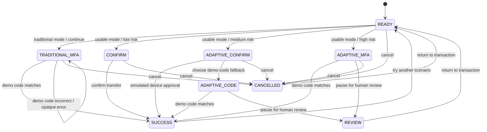

# ClearGate: Usable Security & Transparent Authorization in Mobile Banking

**HCI portfolio prototype | React + TypeScript | Mobile-responsive web UI**

ClearGate is a research prototype exploring how usable-security principles can change a rigid financial authorization workflow into one that is understandable, proportionate to context, and recoverable when something goes wrong. It compares two interface conditions over the same synthetic transfer scenario:

- **Traditional UX:** a fixed multi-factor authentication (MFA) step, minimal explanation, and an illustrative technical error (`ERR_SEC_9942`).
- **Usable Security UX:** an inspectable rule-based risk score, a risk-dependent authorization step, plain-language explanations, retry guidance, and a pause-for-human-review option.

> **Safety and research boundary:** this repository is a user-interface experiment, not a production banking application. It does not connect to a bank, make real transfers, verify identities, store credentials, or detect real fraud. Its scoring rules and cutoffs are invented for the prototype and are not calibrated security policy. Do not enter real personal or banking information.

## 1. Executive summary

### User problem

Security friction can be difficult to understand when users encounter a transaction block, unexplained step-up authentication, or a cryptic error. A person may not know whether the system is responding to a real security concern, what action is safe to take next, or how to recover without abandoning the transaction. Conversely, reducing friction without appropriate controls can create risk. The design challenge is therefore not simply to remove security checks; it is to make security actions understandable and proportionate while preserving meaningful protection and user agency.

Prior work on e-banking authentication has examined the relationship between authentication usability, user experience, perceived security, and familiarity with authentication methods. For example, Weir et al. compared e-banking authentication approaches in a repeated-measures study and found that experience with a familiar method influenced users' perceptions and preferences. See the reference list below.

### Proposed design hypothesis

Compared with the traditional UI, the usable-security UI is expected to:

1. increase users' understanding of why an authorization step appears;
2. reduce perceived workload and recovery errors;
3. improve perceived transparency and control;
4. preserve or improve the appropriate handling of high-risk scenarios, rather than merely making all transfers faster.

These are **hypotheses to test**, not results claimed by this prototype.

### Research questions

- **RQ1 — Comprehension:** Can users accurately explain why a simulated transfer needs additional verification?
- **RQ2 — Workload and recovery:** Does plain-language feedback and an explicit recovery path reduce perceived workload and help users recover from verification errors?
- **RQ3 — Trust and agency:** Does transparent, context-dependent authorization improve calibrated trust and perceived control without encouraging users to approve suspicious activity blindly?

## 2. What to try in the demo

1. Open `index.html` in a modern browser.
2. Keep **Usable Security UX** selected. The initial synthetic case has a new recipient and should show a medium illustrative score.
3. Select **Review security step**. The explanation should describe why an extra confirmation is shown. Try confirmation or choose the demo-code route.
4. Enter an incorrect code to see actionable, plain-language recovery text. The demo code is `246810`.
5. Enable **Unrecognized device**, **Unusual location**, and/or **Rapid activity**. The risk score and next authorization step should update immediately.
6. Choose **Pause for human review** on the high-risk path. The transfer is paused in the simulated workflow.
7. Switch to **Traditional UX** and repeat. The traditional condition always presents the same MFA requirement and uses `ERR_SEC_9942` after an incorrect demo code.
8. Reset the scenario to compare different conditions.

The code string `246810` exists only so a reviewer can complete the prototype. It is not a real OTP flow. Similarly, the “device confirmation” action is a simulation—not a passkey, biometric prompt, or trusted-device attestation.

## 3. Directory structure

```text
usable-security-banking/
├── index.html                     # Self-contained double-click demo (React/Babel/Tailwind CDNs)
├── app.html                       # Entry point for the modular Vite + TypeScript version
├── package.json
├── tsconfig.json
├── vite.config.ts
├── README.md
└── src/
    ├── main.tsx                   # React entry point
    ├── App.tsx                    # Typed interaction UI and state transitions
    ├── styles.css                 # Shared visual style and responsive layout
    ├── types.ts                   # Transaction, risk, mode, stage, and event types
    └── components/
        └── RiskEngine.ts          # Explicit, inspectable risk rule set
```

## 4. Run the project

### Option A — quickest: standalone HTML

No build step is required. Download the repository folder and double-click `index.html`. The standalone file includes its React, ReactDOM, Babel, and Tailwind CDN references, so an internet connection is required to load those libraries. Once loaded, the interface makes no application API calls and uses synthetic data locally.

### Option B — modular TypeScript application

Install Node.js (version 20 or later is recommended), then run in the project folder:

```bash
npm install
npm run dev -- --open app.html
```

To type-check and build the modular app:

```bash
npm run typecheck
npm run build
npm run preview
```

`app.html` is the Vite/TypeScript entry point. The standalone `index.html` is intentionally kept as a one-file demo to satisfy quick portfolio review. The two frontends implement the same interaction concept; keep their logic aligned when making changes.

## 5. HCI heuristic comparison matrix

The matrix applies Nielsen's general usability heuristics to this particular security task. The traditional condition is deliberately a comparison baseline, not a recommended banking design.

| Nielsen heuristic | Traditional UX condition | Usable Security UX condition | Evaluation signal |
|---|---|---|---|
| 1. Visibility of system status | Shows a generic verification-required state. | Shows the current risk band, next step, and a local session activity trail. | Can the user state what the system is asking them to do next? |
| 2. Match between system and the real world | Uses a technical code (`ERR_SEC_9942`) and generic language. | Explains the relevant context in everyday language (e.g., new recipient). | Error/explanation comprehension accuracy. |
| 3. User control and freedom | Provides a fixed challenge and a cancel option. | Provides confirm, alternate demo-code, cancel, and high-risk pause-for-review paths. | Successful completion of a requested cancel or recovery task. |
| 4. Consistency and standards | Uses one fixed MFA requirement regardless of the scenario. | Uses consistent button labels, status language, and a clear sequence of steps. | Observed navigation errors and heuristic-inspection findings. |
| 5. Error prevention | Gives little context before asking for verification. | Repeats recipient and amount at confirmation and explains why the step is shown. | Incorrect-recipient/amount selections in task scenarios. |
| 6. Recognition rather than recall | Requires users to infer a cryptic error's meaning. | Keeps reasons, transaction details, and next steps visible in context. | Need for facilitator help; explanation recall/comprehension. |
| 7. Flexibility and efficiency of use | Same security challenge for every synthetic case. | Low, medium, and high risk bands produce different interaction paths. | Number of steps and task time, interpreted alongside safety outcomes. |
| 8. Aesthetic and minimalist design | A generic block does not explain the decision. | Progressive disclosure exposes reasons alongside the action that needs them. | Clarity ratings and observed scanning behavior. |
| 9. Help users recognize, diagnose, and recover from errors | Incorrect code yields a cryptic error with generic support direction. | Incorrect code yields an understandable message and a recovery choice. | Error recovery rate and repeated failed attempts. |
| 10. Help and documentation | Provides minimal contextual help. | Shows concise notes and explicit prototype-only behavior around sensitive steps. | Requests for external help; qualitative comments. |

Nielsen's heuristics are general inspection principles rather than a security certification. They support the interface critique but do not prove that the simulated control logic is secure.

## 6. Technical architecture and state engine

### Architecture

- **UI (`src/App.tsx`):** renders the transaction details, mode switch, context controls, risk explanation, authorization workflow, and session log.
- **Domain types (`src/types.ts`):** defines the data contract for the transaction, risk assessment, authorization mode, and finite set of interface states.
- **Risk engine (`src/components/RiskEngine.ts`):** pure deterministic function from transaction context to score, band, explanation contributions, and recommended next action.
- **State transitions:** React component state drives the prototype workflow; no server is involved.

### Demo risk function

The model is a deliberately simple heuristic:

```text
score = clamp(8 + amountPoints + payeePoints + devicePoints
                + locationPoints + activityPoints, 0, 100)

amountPoints   = +10 if amount > $1,000; otherwise +5 if amount > $500; otherwise +0
payeePoints    = +24 if recipient is new
 devicePoints  = +22 if device is unrecognized
locationPoints = +18 if location is unusual
activityPoints = +14 if rapid activity is selected

Low:    score < 25  → clear confirmation step
Medium: score < 55  → additional on-device confirmation (or demo-code route)
High:   score ≥ 55  → simulated code verification or pause for human review
```

There is no probability calibration, training data, feature learning, model explanation library, production policy, or protected inference service. The visible contribution values are exactly the hand-coded rules, so the explanation is faithful to the demo logic. This is useful for exploring UI concepts before connecting a real risk service, but it is not evidence that the signals predict fraud or that the thresholds are appropriate.

### Interaction state diagram



**Implementation note:** changing the transaction context during an in-progress interaction returns the workflow to `ready`, preventing stale authorization state from being applied to a changed scenario.

## 7. Empirical usability evaluation plan

This project makes testable design claims but includes no participant data. The following is a proposed formative study, to be reviewed with a supervisor and ethics process before recruitment.

### Study design

- **Design:** within-subject, counterbalanced comparison of Traditional UX and Usable Security UX. Randomize or counterbalance condition order (AB/BA) to reduce learning/order effects.
- **Pilot sample:** approximately 24–30 adult participants who use mobile or online banking. Treat this as a formative study unless a power analysis based on a defined primary outcome justifies a confirmatory sample.
- **Device:** use the same phone-sized viewport or mobile device for both conditions; record device and accessibility needs.
- **Materials:** synthetic accounts, fictitious recipients, fabricated transaction contexts, scripted tasks, comprehension questions, workload and trust questionnaires.
- **Ethics:** obtain informed consent; do not collect credentials, account details, actual banking data, or unnecessary sensitive demographic data. Make clear that the interface is not a real bank and that all transactions are simulated.

### Suggested tasks

1. **Routine transfer:** inspect the recipient and amount, then complete or cancel the transfer as instructed.
2. **Unfamiliar recipient:** explain which factor triggered the additional step and choose an appropriate response.
3. **Verification error:** enter an incorrect code, diagnose what happened, and recover without facilitator help.
4. **High-risk case:** identify why the UI asks for stronger verification and pause the transfer for human review when the task asks you to do so.
5. **Control comprehension:** change one scenario signal and predict how the interface will respond before proceeding.

Counterbalance case order. Include both benign and higher-risk vignettes so the study does not reward the usable interface merely for being faster or making authorization easier.

### Outcomes and instrumentation

| Measure | Operationalization | Why it matters |
|---|---|---|
| Task completion rate | Percentage of tasks completed correctly without facilitator assistance, per condition. Report separately by task type. | Captures successful use, not only speed. |
| Task completion time | Time from task prompt to correct completion or justified cancellation. | Provides efficiency evidence; interpret alongside errors and safety. |
| Error and recovery rate | Incorrect actions, repeated failed codes, abandoned tasks, successful recovery after an error. | Directly tests error prevention and recoverability. |
| Risk-reason comprehension | Short post-task questions asking which visible context triggered the step and why. Score answers against a pre-defined rubric. | Tests whether transparency was understood, not merely displayed. |
| NASA-TLX | Use the NASA Task Load Index per condition, following the chosen official instructions and scoring method. Report subscales and overall score as appropriate. | Measures subjective workload across mental, physical, and temporal demand, performance, effort, and frustration. |
| Perceived trust and control | Short post-condition questionnaire covering transparency, confidence in understanding the check, perceived control, perceived fairness, and confidence to challenge an unexpected result. | Evaluates user perception; do not equate increased trust with safer behavior. |
| Unsafe authorization behavior | Count whether a participant authorizes a simulated transaction that the task explicitly identifies as suspicious, or fails to use the requested review route. | Guards against a design that lowers friction by encouraging indiscriminate approval. |
| Qualitative feedback | Brief think-aloud notes and semi-structured interview: what was clear, confusing, intrusive, or missing? | Helps explain quantitative differences and uncover usability issues. |

NASA-TLX is a subjective workload measure with six subscales. Follow the official NASA instructions; do not silently replace or relabel its items. For the trust/control questionnaire, select an established instrument with an appropriate validation and usage plan if possible. If using custom items, label them researcher-created and pilot them rather than presenting them as a validated scale.

### Pre-registered hypotheses (suggested)

- **H1:** Correct risk-reason comprehension is higher in the Usable Security UX condition.
- **H2:** NASA-TLX workload is lower in the Usable Security UX condition for the recovery task.
- **H3:** Users report greater perceived control and clarity in the Usable Security UX condition.
- **H4 (safety guardrail):** The usable condition does not increase unsafe authorization behavior in the higher-risk task.

Define the primary outcome and analysis plan before data collection. For a small formative sample, report paired differences, confidence intervals, distributions, and qualitative themes; avoid strong generalization from a small convenience sample. Do not claim improved trust, security, or usability until data support the claim.

## 8. Accessibility, privacy, and design limitations

- The layout is responsive and includes semantic labels, status regions, visible focus styling, and reduced-motion support.
- Color is paired with text labels in the risk panel; users should not need color alone to interpret the current state.
- The scenario context toggles are exposed so a researcher can reproduce conditions, but they are not connected to telemetry or real fraud signals.
- Session events live only in local React state and disappear when the page is reloaded.
- The prototype has no backend authorization service, secure session management, device attestation, cryptographic challenge, server-side rate limiting, fraud monitoring, audit retention, or accessibility audit.
- Static demo code and simulated device approval intentionally make the interaction testable; both would be unacceptable substitutes for real authentication controls.
- Risk-adaptive controls require careful threat modelling: attackers may try to manipulate signals, thresholds can be unfair or inaccurate, and the interface must not expose sensitive information that would enable evasion. A real implementation needs independent security review, policy governance, monitoring, fail-safe behavior, and human escalation service design.

## 9. Further work

1. Run a formative heuristic evaluation with security, accessibility, and banking-domain reviewers.
2. Pilot the task script and trust/workload measures, revising ambiguous tasks before recruitment.
3. Compare alternative explanation styles (short reason, expandable detail, and counterfactual guidance) without changing the underlying simulated decision logic.
4. Test accessible recovery methods and interruption/resumption, especially for users without access to a primary device.
5. Only in a separate engineering phase, connect a properly governed authorization service and independently evaluated risk engine. Do not treat this front-end demo as a security boundary.

## 10. References

1. Nielsen Norman Group. (2024, review date). **10 Usability Heuristics for User Interface Design.** https://www.nngroup.com/articles/ten-usability-heuristics/
2. NASA Human Systems Integration Division. **NASA Task Load Index (TLX).** https://www.nasa.gov/human-systems-integration-division/nasa-task-load-index-tlx/
3. Weir, C. S., Douglas, G., Richardson, T., & Jack, M. (2010). **Usable security: User preferences for authentication methods in eBanking and the effects of experience.** *Interacting with Computers, 22*(3), 153–164. https://doi.org/10.1016/j.intcom.2009.10.001

---

### Portfolio presentation note

When presenting this project for an HCI application, frame it as a **testable interaction design and evaluation proposal**: identify the user problem, show the prototype contrast, explain design trade-offs, and state what you would measure. Be transparent that no user study or real-world security validation has yet been conducted. A few documented pilot observations and iteration notes—collected ethically—would make the case study more credible than claiming the prototype already improves trust or security.
# usable-security-banking
